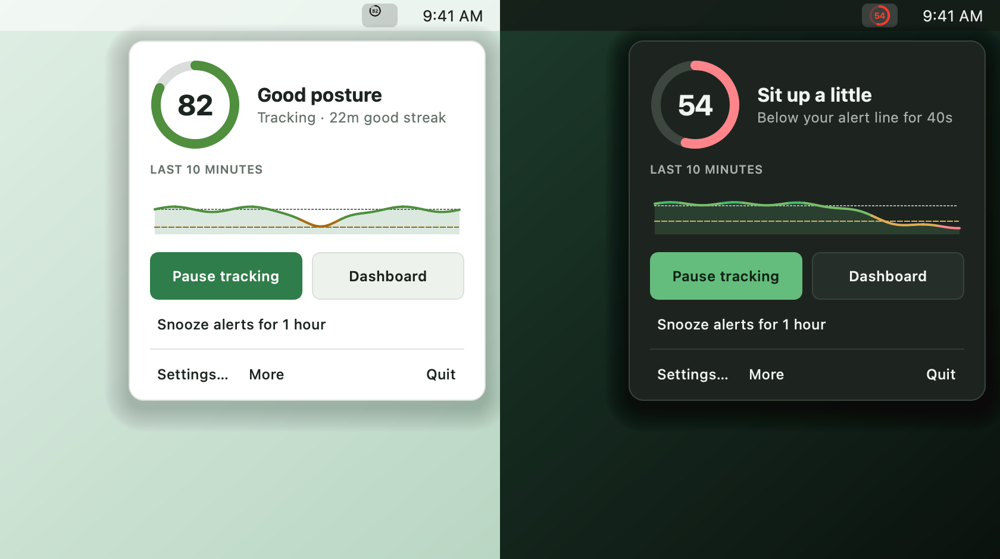
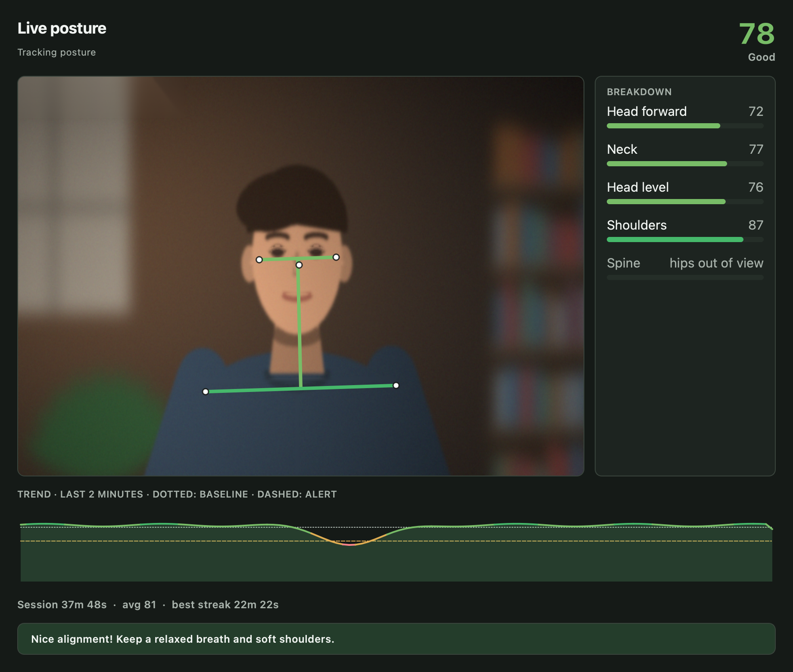
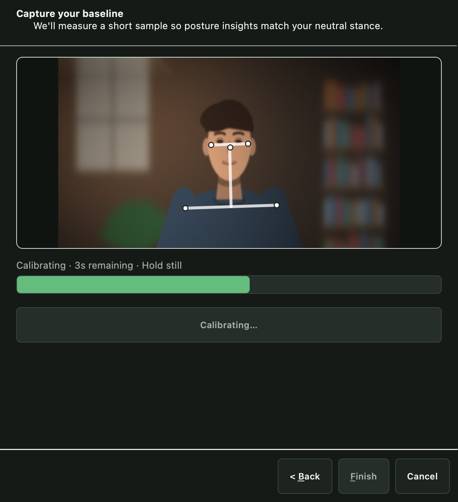

<div align="center">

# BatesPosture

**A local-first desktop posture monitor. Webcam in, private posture feedback out.**

[](https://github.com/wtbates99/batesposture/actions/workflows/data-checks.yml)
[](https://www.python.org/)
[](https://ai.google.dev/edge/mediapipe/solutions/vision/pose_landmarker)
[](LICENSE)

[**Install**](#install) · [**How it works**](#how-it-works) · [**Privacy**](#privacy) · [**License**](#license)

</div>


BatesPosture watches a webcam locally, scores posture from 0–100, and sends a
native notification when posture drops below a personal threshold. Calibration
tunes the measurements to the person using the app. There are no accounts,
cloud uploads, or telemetry.

## What it provides

| Capability | Behavior |
| --- | --- |
| Live score | Weighted head, neck, shoulder and spine measurements become one 0–100 score |
| Menu-bar popover | Score ring, ten-minute trend, and pause, dashboard and snooze controls one click from the menu bar |
| Personal calibration | A six-second baseline, taken only once head and shoulders are in frame |
| Session dashboard | Auto-framed camera view, colour-coded skeleton, per-measurement breakdown, trend, average and best streak |
| Calm alerts | Notify only after sustained poor posture, with cooldown, focus mode and a one-hour snooze |
| Scheduling | Continuous or interval tracking plus configurable break reminders |
| Local history | Optional SQLite logging and CSV export |
| Light on the CPU | 2 FPS while the dashboard is closed, and no pose inference while you sit still |
| Auto-pause | Away-from-desk time is excluded when no person is detected |

### In the menu bar

A template icon that matches the menu bar until posture needs attention, and a
popover with the score, recent trend and the controls used day to day.



### Live dashboard



## Install

Requires Python 3.11 or newer, [uv](https://docs.astral.sh/uv/), and a webcam.

```bash
git clone https://github.com/wtbates99/batesposture.git
cd batesposture
uv sync --locked --all-groups
uv run batesposture
```

Grant camera permission and complete the calibration when prompted.

<details>
<summary><strong>Linux system packages</strong></summary>

On Debian or Ubuntu:

```bash
sudo apt-get update
sudo apt-get install -y \
  libgl1 libglib2.0-0 \
  libxcb-xinerama0 libxcb-cursor0 libxcb-icccm4 libxcb-image0 \
  libxcb-keysyms1 libxcb-randr0 libxcb-render-util0 libxcb-shape0 \
  libxcb-xfixes0 libxkbcommon-x11-0 libegl1 libgles2
```

GNOME users may also need an AppIndicator extension for the tray icon.

</details>

## How it works



1. **Calibrate** — capture a six-second baseline of the user's natural posture.
2. **Track** — MediaPipe landmarks feed seven geometric measurements.
3. **Score** — weighted measurements produce one 0–100 posture score.
4. **Alert** — a sustained low score triggers a cooldown-controlled notification.
5. **Review** — the dashboard shows the current session and optional saved history.

<br clear="right">

## Configuration

Settings are available in the desktop UI and through environment variables:

```bash
POSTURE_RUNTIME_DEFAULT_CAMERA_ID=1 uv run batesposture
POSTURE_RUNTIME_DEFAULT_FPS=15 uv run batesposture
POSTURE_RUNTIME_POOR_POSTURE_THRESHOLD=55 uv run batesposture
```

Environment names follow `POSTURE_<SECTION>_<FIELD>` for runtime, ML, and
profile settings.

## Privacy

- Video frames are processed locally and are not uploaded.
- Posture data does not leave the machine.
- There are no accounts, analytics, or telemetry.
- The MediaPipe pose model is downloaded once from Google's model storage on first
  use and cached locally; no data is sent.
- SQLite logging is opt-in and disabled by default.
- README screenshots use synthetic imagery and contain no biometric data.

Data locations vary by platform:

| Data | Location |
| --- | --- |
| Database, lock, and pose models | Linux `~/.local/share/BatesPosture/`; macOS application support; Windows `%APPDATA%` |
| Logs | macOS `~/Library/Logs/BatesPosture/app.log`; other platforms `~/.batesposture_logs/app.log` |
| CSV exports | `~/posture_export_YYYYMMDD_HHMMSS.csv` |

## Development

```bash
uv sync --locked --all-groups
QT_QPA_PLATFORM=offscreen uv run python -m pytest
uv run pre-commit run --all-files
uv build
```

## Troubleshooting

- **Camera does not open:** close other camera applications or try camera index `1`.
- **Tracking pauses:** make sure the head and shoulders are visible and evenly lit.
- **Performance is poor:** choose the Lite model; with the dashboard closed tracking already
  drops to 2 FPS.
- **CSV export is empty:** enable database logging before recording a session.

## License

BatesPosture is **source available** under the
[PolyForm Noncommercial License 1.0.0](LICENSE). Personal and noncommercial
use is permitted under those terms. Commercial use requires a
[separate license](COMMERCIAL-LICENSE.md).

Earlier revisions remain governed by the terms under which they were
published; see [license history](LICENSE_HISTORY.md).
